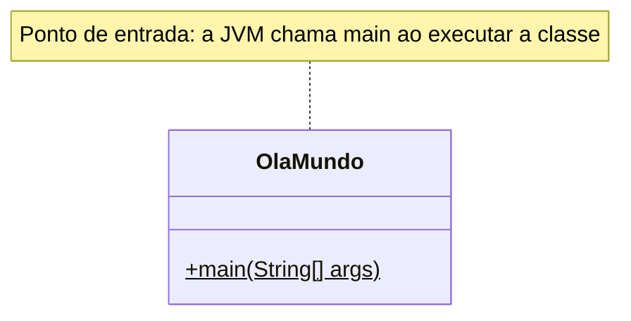

# 001 — Olá, Mundo

**Tema:** Primeiro programa em Java

## Problema de design

Antes de pedir qualquer sistema a uma IA, é preciso reconhecer a estrutura mínima de um programa Java: a classe, o pacote e o método `main` por onde a execução começa. Sem isso, você não consegue dizer onde colocar o código que a IA entrega nem entender por que ele não roda. Mesmo um "Olá, Mundo" pedido sem contexto pode vir num formato que o seu projeto não compila, ou dentro de um framework inteiro que você não pediu.

## Objetivo

Escrever e executar o primeiro programa Java, que imprime uma mensagem na saída padrão.

## Conceitos-chave

- Estrutura mínima de uma classe Java
- Método `main(String[] args)` como ponto de entrada
- `System.out.println`
- Comentários Javadoc

## Diagrama de classes



## Classes principais

| Classe | Papel |
|---|---|
| `OlaMundo` | Aplicação: imprime "Olá, Mundo!!!" (Java 17, em `src/main/java`) |
| `java25/OlaMundo.java` | O mesmo programa na forma do Java 25: arquivo compacto, fora do build do Maven |

## O que é Maven

O [Maven](https://maven.apache.org/) é a ferramenta que **compila, testa, empacota e executa** projetos Java e que **baixa as bibliotecas** de que eles dependem. Tudo o que ele precisa saber está no `pom.xml` (*Project Object Model*): o nome e a versão do projeto, a versão do Java, as dependências e os plugins.

O Maven também impõe uma **estrutura de pastas padrão**:

```
001-ola-mundo/
├── pom.xml                       ← descrição do módulo
└── src/
    ├── main/java/                ← código da aplicação
    │   └── br/com/cidandrade/aulas/
    │       └── OlaMundo.java     ← a pasta repete o pacote
    └── test/java/                ← testes (quando houver)
```

Neste curso, o `pom.xml` da raiz do repositório é o **pai**. Ele fixa o Java 17 e as versões das bibliotecas e lista cada aula como um **módulo**. O `pom.xml` de cada aula é curto, porque herda tudo do pai.

| Comando | O que faz |
|---|---|
| `mvn compile` | Compila o código de `src/main/java` |
| `mvn test` | Compila e roda os testes de `src/test/java` |
| `mvn package` | Gera o `.jar` em `target/` |
| `mvn install` | Instala o `.jar` no repositório local, para outros módulos usarem |
| `mvn exec:java` | Executa a classe principal (plugin `exec`) |

**Por que isso importa ao pedir código a uma IA:** dizer "projeto Maven" faz a IA colocar os arquivos nas pastas certas e declarar as dependências no `pom.xml`, em vez de mandar baixar arquivos `.jar` à mão. A principal alternativa ao Maven é o Gradle (`build.gradle`). Se a IA trouxer Gradle para um projeto Maven, recuse.

## O que são frameworks

Uma **biblioteca** é código pronto que **você chama**: a API `java.time` (aula [021](../../03-colecoes-e-apis/021-datas)) e o JFreeChart (aula [057](../../08-arquitetura-e-persistencia/057-grafico)), por exemplo. Um **framework** é código pronto que **chama o seu código**: ele controla o fluxo do programa, e você preenche os pontos que ele prevê, com classes anotadas, interfaces implementadas ou métodos com nomes combinados. Essa inversão é chamada de **inversão de controle**.

| Framework | Para quê | Como ele chama o seu código |
|---|---|---|
| JUnit | Testes (aula [063](../../10-projetando-com-ia/063-testes-com-junit)) | Encontra e executa os métodos marcados com `@Test` |
| Swing | Interfaces gráficas (aula [024](../../04-interface-grafica-e-integracao/024-calculadora)) | Chama o seu tratador quando um botão é clicado |
| Spring Boot, Jakarta EE, Quarkus | Aplicações web e corporativas | Cria os seus objetos, injeta as dependências e chama os seus métodos a cada requisição |

Um framework traz muita coisa pronta, mas cobra o preço: dependências, configuração, regras próprias e mais código para entender e revisar.

**Por que isso importa ao pedir código a uma IA:** as IAs costumam trazer frameworks sem que ninguém peça ("faça uma API" pode virar um projeto Spring Boot inteiro). Diga **"sem frameworks"**, ou diga qual framework você quer. Para um "Olá, Mundo", nenhum framework faz sentido.

## Java 17 × Java 25

O Java ganha uma versão nova a cada seis meses. A cada dois anos, uma delas é **LTS** (*Long-Term Support*), com anos de atualizações garantidas: o Java 17 (2021), o 21 (2023) e o 25 (2025). Este curso compila em **Java 17**, a versão mínima, e por isso o código em `src/main/java` usa a forma clássica. A pasta [`java25`](java25) traz o mesmo programa na forma que o Java 25 permite.

**Java 17**, em `src/main/java/br/com/cidandrade/aulas/OlaMundo.java` (aqui sem os comentários Javadoc):

```java
package br.com.cidandrade.aulas;

public class OlaMundo {

    public static void main(String[] args) {
        System.out.println("Olá, Mundo!!!");
    }

}
```

**Java 25**, em `java25/OlaMundo.java`:

```java
void main() {
    IO.println("Olá, Mundo!!!");
}
```

| | Java 17 | Java 25 (arquivo compacto) |
|---|---|---|
| Classe | Obrigatória: `public class OlaMundo` | Implícita: o compilador cria a classe a partir do arquivo |
| Método `main` | `public static void main(String[] args)` | `void main()`: pode ser de instância, sem `public` nem `static`, e os parâmetros são opcionais |
| Escrever na tela | `System.out.println` | `IO.println`, da classe `java.lang.IO`, nova no Java 25. `System.out.println` continua valendo |
| Pacote | `package br.com.cidandrade.aulas;` | Não pode ter: o arquivo compacto fica no pacote sem nome |
| `import` | Só `java.lang` vem automaticamente | Todos os pacotes do módulo `java.base` (`java.util`, `java.time`, `java.io`...) vêm automaticamente |
| Indicado para | Projetos de qualquer tamanho | Primeiros programas, scripts e protótipos; quando o programa cresce, vira uma classe comum |

Três observações:

- O código Java 17 compila e roda sem mudança no JDK 25: as versões novas mantêm a compatibilidade com as anteriores.
- O caminho inverso não funciona. Em Java 17, o arquivo compacto nem compila (`implicitly declared classes are not supported in -source 17`). Do Java 21 ao 24, o `void main()` sem classe só existe como recurso em prévia (`--enable-preview`), e a classe `IO` só aparece no Java 23, ainda em prévia e em outro pacote (`java.io.IO`). Por isso, este arquivo exige o Java 25.
- Para executar a versão Java 25, use um JDK 25 ou mais recente, na raiz do repositório: `java 01-fundamentos/001-ola-mundo/java25/OlaMundo.java`. O comando `java` compila o arquivo na memória e o executa. Esse modo de rodar um arquivo-fonte existe desde o Java 11.

## Como pedir à IA

Termos que levam a IA a este desenho: **Java 17**, **classe com `public static void main(String[] args)`**, **pacote**, **projeto Maven**, **sem frameworks**, **explique cada linha**.

Exemplo de pedido:

> Escreva um "Olá, Mundo" em Java 17, sem frameworks, para um projeto Maven.
>
> - Use uma classe pública `OlaMundo` no pacote `br.com.cidandrade.aulas`, com o método `public static void main(String[] args)`.
> - Diga em que pasta o arquivo deve ficar.
> - Explique em uma frase o papel de cada linha.
> - Não use o "main compacto" (`void main()` sem classe), porque o projeto compila em Java 17.

## Como revisar o código

Ao receber o código da IA, confira:

- [ ] O nome da classe pública é igual ao nome do arquivo (`OlaMundo` em `OlaMundo.java`)
- [ ] A declaração `package` corresponde à pasta (`src/main/java/br/com/cidandrade/aulas`)
- [ ] A assinatura é `public static void main(String[] args)`. O `void main()` sem classe só existe como prévia do Java 21 ao 24 e é definitivo a partir do Java 25; em Java 17, não compila
- [ ] Não vieram dependências nem frameworks (Spring Boot, por exemplo) para um programa de uma linha
- [ ] O código compila e roda com o comando do projeto (`mvn -q -pl 01-fundamentos/001-ola-mundo exec:java`)

## Como executar

Na raiz do repositório:

```bash
mvn -q install -DskipTests      # uma única vez: compila tudo e instala a biblioteca da aula 008
mvn -q -pl 01-fundamentos/001-ola-mundo exec:java
```

Classe principal: `br.com.cidandrade.aulas.OlaMundo`. Na IDE, basta executar essa classe.

## Navegação

[Sumário do curso](../../README.md#sumário) · [002 — Carro](../../01-fundamentos/002-carro) →

## Origem

Este código veio do repositório [`cidandrade/Codigo-001---Ola-Mundo`](https://github.com/cidandrade/Codigo-001---Ola-Mundo), hoje arquivado.
