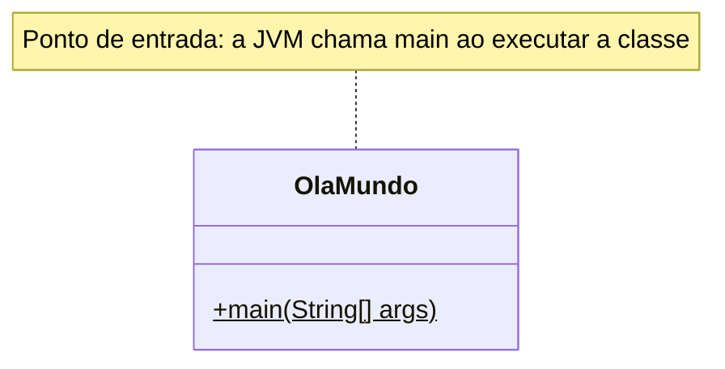

# 001 — Olá, Mundo

**Tema:** Primeiro programa em Java

## Problema de design

Antes de pedir qualquer sistema a uma IA, é preciso reconhecer a estrutura mínima de um programa Java: a classe, o pacote e o método `main` por onde a execução começa. Sem isso, você não consegue dizer onde colocar o código que a IA entrega nem entender por que ele não roda. Mesmo um "Olá, Mundo" pedido sem contexto pode vir num formato que o seu projeto não compila, ou dentro de um framework inteiro que você não pediu.

## Objetivo

Escrever e executar o primeiro programa Java, que imprime uma mensagem na saída padrão.

## Conceitos-chave

- Estrutura mínima de uma classe Java
- Método `main(String[] args)` como ponto de entrada
- `System.out.println`
- Comentários Javadoc

## Diagrama de classes



## Classes principais

| Classe | Papel |
|---|---|
| `OlaMundo` | Aplicação: imprime "Olá, Mundo!!!" |

## Como pedir à IA

Termos que levam a IA a este desenho: **Java 17**, **classe com `public static void main(String[] args)`**, **pacote**, **projeto Maven**, **sem frameworks**, **explique cada linha**.

Exemplo de pedido:

> Escreva um "Olá, Mundo" em Java 17, sem frameworks, para um projeto Maven.
>
> - Use uma classe pública `OlaMundo` no pacote `br.com.cidandrade.aulas`, com o método `public static void main(String[] args)`.
> - Diga em que pasta o arquivo deve ficar.
> - Explique em uma frase o papel de cada linha.
> - Não use o "main compacto" (`void main()` sem classe), porque o projeto compila em Java 17.

## Como revisar o código

Ao receber o código da IA, confira:

- [ ] O nome da classe pública é igual ao nome do arquivo (`OlaMundo` em `OlaMundo.java`)
- [ ] A declaração `package` corresponde à pasta (`src/main/java/br/com/cidandrade/aulas`)
- [ ] A assinatura é `public static void main(String[] args)`. O `void main()` sem classe só existe como prévia no Java 21 e é definitivo a partir do Java 25; em Java 17, não compila
- [ ] Não vieram dependências nem frameworks (Spring Boot, por exemplo) para um programa de uma linha
- [ ] O código compila e roda com o comando do projeto (`mvn -q -pl 01-fundamentos/001-ola-mundo exec:java`)

## Como executar

Na raiz do repositório:

```bash
mvn -q install -DskipTests      # uma única vez: compila tudo e instala a biblioteca da aula 008
mvn -q -pl 01-fundamentos/001-ola-mundo exec:java
```

Classe principal: `br.com.cidandrade.aulas.OlaMundo`. Na IDE, basta executar essa classe.

## Navegação

[Sumário do curso](../../README.md#sumário) · [002 — Carro](../../01-fundamentos/002-carro) →

## Origem

Este código veio do repositório [`cidandrade/Codigo-001---Ola-Mundo`](https://github.com/cidandrade/Codigo-001---Ola-Mundo), hoje arquivado.
