# 002 — Carro

**Tema:** Classes e objetos

## Problema de design

Um objeto é responsável pelo próprio estado válido. Declarar os atributos como `private` não basta: se os métodos aceitam qualquer valor, `frear(200)` deixa a velocidade negativa, `mudarMarcha(99)` engata uma marcha que não existe e um carro a 80 km/h engata a ré. Quem pede "uma classe Carro" a uma IA sem dizer as regras costuma receber getters e setters para todos os atributos, e aí qualquer parte do programa consegue deixar o carro inválido. As regras (os **invariantes**) precisam estar no pedido, e o código precisa recusar o que as viola. Há dois tipos de recusa: o valor em si é inválido (marcha 99), ou o valor é válido, mas não no estado atual (ré com o carro andando).

## Objetivo

Criar a primeira classe com estado (atributos) e comportamento (métodos) e instanciar dois objetos independentes dela.

## Conceitos-chave

- Classe × objeto
- Atributos privados e encapsulamento
- Invariantes: o objeto recusa operações que o deixariam inválido
- `IllegalArgumentException` (argumento inválido) × `IllegalStateException` (argumento válido, mas proibido no estado atual)
- Métodos que alteram o estado do objeto
- Getters só de leitura e `toString()`
- Operador `new`
- Organização em pacotes (`classes`)

## Diagrama de classes

```mermaid
classDiagram
    class Carro {
        -int velocidade
        -int marcha
        +mudarMarcha(int novaMarcha)
        +aumentarVelocidade(int incremento)
        +frear(int decremento)
        +getVelocidade() int
        +getMarcha() int
        +toString() String
    }
    class CarroApp {
        +main(String[] args)$
    }
    CarroApp ..> Carro : cria dois objetos
    note for Carro "Invariantes: velocidade >= 0; marcha de -1 (ré) a 5;
não acelera em ponto morto; andando, não entra na ré nem sai dela"
```



## Classes principais

| Classe | Papel |
|---|---|
| `Carro` | Guarda velocidade (nunca negativa) e marcha (de -1, a ré, até 5); oferece `mudarMarcha`, `aumentarVelocidade`, `frear`, os getters e `toString` |
| `CarroApp` | Aplicação: cria dois carros, mostra que cada um tem seu próprio estado e manobra um deles de ré (Java 17, em `src/main/java`) |
| `java25/CarroApp.java` | O mesmo programa na forma do Java 25: arquivo compacto, com `Carro` como classe aninhada, fora do build do Maven |

## Lançar uma exceção

Quando alguém pede ao carro algo que quebraria uma regra, o método **lança uma exceção** com `throw`: a operação não acontece, o estado do objeto fica como estava e o programa para com uma mensagem.

```java
if (novaMarcha < RE || novaMarcha > MARCHA_MAXIMA) {
    throw new IllegalArgumentException("Marcha inválida: " + novaMarcha
            + " (use de " + RE + " a " + MARCHA_MAXIMA + ")");
}
```

Esta aula usa duas exceções que já vêm com o Java:

| Exceção | Quando | Exemplo no `Carro` |
|---|---|---|
| `IllegalArgumentException` | O valor recebido é inválido em qualquer situação | `mudarMarcha(6)`, `frear(-5)` |
| `IllegalStateException` | O valor é válido, mas o estado atual do objeto não permite | Acelerar em ponto morto; engatar a ré a 120 km/h |

**Experimente:** na `CarroApp`, descomente a linha `// carro1.mudarMarcha(-1);` e execute de novo. A saída será:

```
Carro a 120 km/h em 5ª marcha
Exception in thread "main" java.lang.IllegalStateException: Não é possível passar da marcha 5 para a -1 com o carro a 120 km/h: pare o carro antes
	at br.com.cidandrade.aulas.classes.Carro.mudarMarcha(Carro.java:45)
	at br.com.cidandrade.aulas.CarroApp.main(CarroApp.java:30)
```

Leia de cima para baixo: o tipo da exceção, a mensagem e a **pilha de chamadas**, que mostra onde a exceção foi lançada (`Carro.java`, linha 45) e quem chamou o método (`CarroApp.java`, linha 30). O segundo carro não chega a ser criado, porque o programa parou.

Aqui o objetivo é só **lançar**: o `Carro` recusa a operação. **Tratar** a exceção (`try`/`catch`), para que o programa continue, fica para a aula [007](../007-entrada-e-saida).

Duas outras novidades aparecem de passagem: o `if`, detalhado na aula [012](../../02-recursos-da-linguagem/012-decisao-e-repeticao), e o `toString()`, um método que todo objeto Java já tem e que o `Carro` substitui (`@Override`) para se descrever em texto. O motivo de todo objeto já ter esse método fica claro na aula [003](../003-heranca), sobre herança.

## Java 17 × Java 25

Como na aula [001](../001-ola-mundo#java-17--java-25), a pasta [`java25`](java25) traz o mesmo programa na forma que o Java 25 permite. Desta vez há duas classes, e isso mostra o limite do arquivo compacto.

| | Java 17 (`src/main/java`) | Java 25 (`java25/CarroApp.java`) |
|---|---|---|
| Arquivos | Dois: `CarroApp.java` e `classes/Carro.java` | Um só |
| Pacotes | `br.com.cidandrade.aulas` e `br.com.cidandrade.aulas.classes` | Nenhum: o arquivo compacto fica no pacote sem nome |
| Classe da aplicação | `public class CarroApp` com `public static void main(String[] args)` | Implícita, com `void main()` |
| Classe `Carro` | Classe pública, no próprio arquivo | Declarada no mesmo arquivo: vira uma **classe aninhada** da classe implícita |
| Quem pode usar `Carro` | Qualquer classe que a importe | Só o próprio arquivo: a classe implícita não tem nome que outro código possa citar |
| Escrever na tela | `System.out.println(carro1)` | `IO.println(carro1)` |

As regras do `Carro` (os `if`s, as exceções, o `toString`) são idênticas nas duas versões: o Java 25 muda a forma do arquivo, não a orientação a objetos.

**Conclusão:** o arquivo compacto serve para experimentar uma classe nova num único arquivo. Quando outra parte do programa precisa usá-la, ela ganha arquivo e pacote próprios, como na versão Java 17.

Para executar a versão Java 25, use um JDK 25 ou mais recente, na raiz do repositório: `java 01-fundamentos/002-carro/java25/CarroApp.java`.

## Como pedir à IA

Termos que levam a IA a este desenho: **classe com atributos privados**, **invariantes**, **sem setters públicos**, **`IllegalArgumentException` para argumento inválido**, **`IllegalStateException` para operação proibida no estado atual**, **getters só de leitura**, **`toString()`**, **sem Lombok**.

Exemplo de pedido:

> Escreva em Java 17, sem frameworks e sem Lombok, a classe `Carro` no pacote `br.com.cidandrade.aulas.classes`.
>
> - Estado: velocidade (km/h) e marcha, ambos `int` e `private`, começando em 0.
> - Invariantes:
>   - a velocidade nunca é negativa (é o módulo; o sentido vem da marcha);
>   - a marcha vai de -1 (ré) a 5, e 0 é o ponto morto;
>   - em ponto morto, o carro não acelera, mas pode frear;
>   - com o carro andando, não se entra na ré nem se sai dela, nem para o ponto morto (que não guarda o sentido do movimento).
> - Operações: `mudarMarcha(int)`, `aumentarVelocidade(int)` e `frear(int)`. Não crie setters.
> - Lance `IllegalArgumentException` para marcha fora da faixa e para incremento ou decremento negativo, e `IllegalStateException` para acelerar em ponto morto e para entrar na ré ou sair dela com o carro andando. As mensagens devem dizer o que estava errado. Se o decremento for maior que a velocidade, o carro para (velocidade 0).
> - Ofereça `getVelocidade()`, `getMarcha()` e um `toString()` como "Carro a 120 km/h em 5ª marcha". A classe não imprime nada na tela.
> - Escreva também uma `CarroApp` que cria dois carros e mostra que cada um guarda o próprio estado.

## Como revisar o código

Ao receber o código da IA, confira:

- [ ] Os atributos são `private` e **não** são `static`: um atributo `static` faria os dois carros dividirem a mesma velocidade
- [ ] Não vieram `setVelocidade` nem `setMarcha`: o estado só muda pelas operações do domínio
- [ ] Cada operação valida antes de alterar o estado: `IllegalArgumentException` quando o valor é inválido, `IllegalStateException` quando o valor é válido mas o estado atual não permite, sempre com mensagem que diz o que estava errado
- [ ] Nenhum caminho deixa a velocidade negativa (teste `frear` com um valor maior que a velocidade)
- [ ] Acelerar em ponto morto é recusado, e engatar a ré a 80 km/h também (teste os dois casos)
- [ ] Procure brechas que passam por um estado intermediário: de ré a 5 km/h, pôr em ponto morto e engatar a 1ª não pode inverter o sentido com o carro andando
- [ ] A classe de domínio não usa `System.out`: quem imprime é a aplicação, a partir do `toString()`
- [ ] Não veio Lombok (`@Data`, `@Setter`): ele gera setters para todos os atributos e desfaz as regras
- [ ] O código compila e roda com o comando do projeto (`mvn -q -pl 01-fundamentos/002-carro exec:java`)

## Como executar

Na raiz do repositório:

```bash
mvn -q install -DskipTests      # uma única vez: compila tudo e instala a biblioteca da aula 008
mvn -q -pl 01-fundamentos/002-carro exec:java
```

Classe principal: `br.com.cidandrade.aulas.CarroApp`. Na IDE, basta executar essa classe.

## Navegação

← [001 — Olá, Mundo](../../01-fundamentos/001-ola-mundo) · [Sumário do curso](../../README.md#sumário) · [003 — Herança](../../01-fundamentos/003-heranca) →

## Origem

Este código veio do repositório [`cidandrade/Codigo-002---Carro`](https://github.com/cidandrade/Codigo-002---Carro), hoje arquivado.
