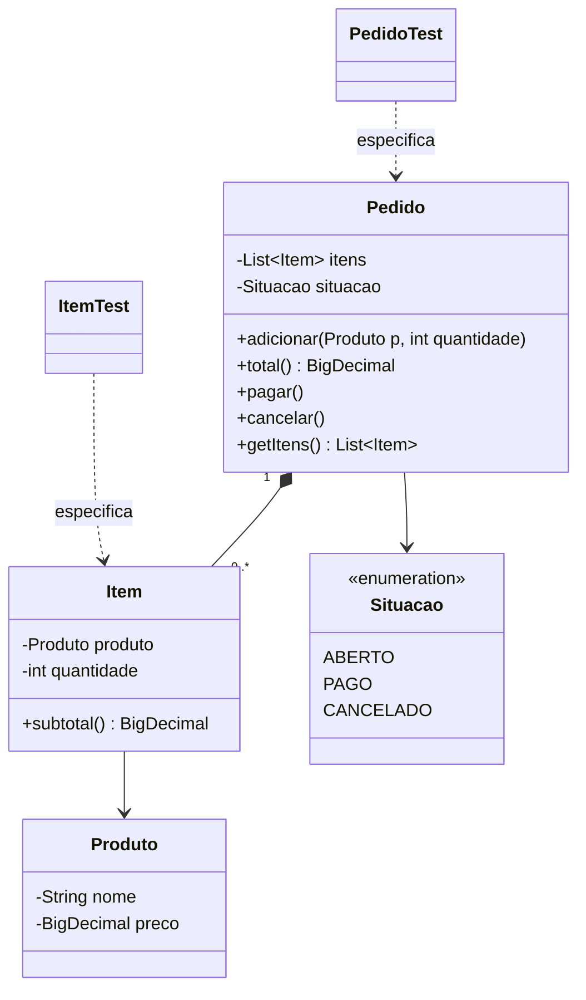

# 063 — Testes com JUnit

**Tema:** Testes automatizados como especificação

## Problema de design

Você pediu à IA um sistema de pedidos e recebeu código que compila e roda. Mas ele respeita as regras? Um pedido vazio pode ser pago? Um pedido pago pode ser cancelado? Ler o código linha por linha a cada nova versão não escala. Testes automatizados escrevem as regras de um jeito que o computador confere sozinho, e servem tanto para **dizer à IA o que você quer** quanto para **verificar o que ela entregou**.

## Objetivo

Especificar as regras de um pedido de cafeteria com testes JUnit e usar esses testes como contrato: o código só está pronto quando todos passam.

## Conceitos-chave

- Teste como especificação executável: o nome do teste descreve uma regra de negócio
- Roteiro Arrange, Act, Assert (preparar, agir, verificar)
- `@Test`, `@DisplayName`, `@BeforeEach` e `@Nested`
- `assertEquals`, `assertThrows` e `assertAll`
- Testes parametrizados: `@ParameterizedTest` com `@CsvSource` e `@ValueSource`
- Casos de borda: vazio, zero, negativo, em branco
- Teste de mutação manual: quebrar uma regra de propósito e ver se algum teste falha
- JUnit 6, com a mesma API Jupiter (`org.junit.jupiter`) do JUnit 5

## Diagrama de classes



## Classes principais

| Classe | Papel |
|---|---|
| `Produto` | Nome e preço; imutável; recusa nome em branco e preço que não seja positivo |
| `Item` | Produto e quantidade; calcula o `subtotal` |
| `Pedido` | Guarda os itens, calcula o `total` e controla a `Situacao` (só paga se estiver aberto e com itens; não cancela se estiver pago) |
| `Situacao` | Enumeração: `ABERTO`, `PAGO`, `CANCELADO` |
| `PedidoTest` | **Especificação** do pedido: um teste por regra, agrupados com `@Nested` |
| `ItemTest` | **Especificação** de produto e item, com testes parametrizados |
| `PedidoApp` | Aplicação: monta, paga e tenta cancelar um pedido |

## Como pedir à IA

Termos que levam a IA a este desenho: **testes JUnit 5 (API Jupiter)**, **um teste por regra**, **casos de borda**, **Arrange-Act-Assert**, **`assertThrows`**, **teste parametrizado**, **TDD (os testes vêm antes do código)**.

Exemplo de pedido:

> Vou te passar as regras de um pedido de cafeteria. Ainda não escreva o código de produção.
>
> 1. Escreva testes JUnit 5 (Jupiter) que especifiquem estas regras, um teste por regra, com `@DisplayName` em português:
>    - pedido novo está ABERTO, vazio e com total zero;
>    - o total é a soma de preço × quantidade de cada item, em `BigDecimal`;
>    - só um pedido ABERTO aceita itens;
>    - pedido vazio não pode ser pago;
>    - pedido pago não pode ser cancelado;
>    - quantidade e preço devem ser maiores que zero.
> 2. Inclua casos de borda (zero, negativo, texto em branco) com testes parametrizados.
>
> Depois que eu aprovar os testes, vou pedir as classes `Produto`, `Item` e `Pedido` para fazê-los passar, sem alterar nenhum teste.

## Como revisar o código

Ao receber o código da IA, confira:

- [ ] Cada regra do enunciado tem pelo menos um teste, e cada teste verifica uma regra só
- [ ] Os nomes (`@DisplayName`) descrevem regras de negócio, e não métodos ("recusa pedido vazio", e não "testPagar2")
- [ ] Há testes para os casos de borda e para os caminhos de erro (`assertThrows`), não só para o caminho feliz
- [ ] Os testes verificam o resultado (`assertEquals` com valor esperado), e não apenas que "não deu erro"
- [ ] Valores em dinheiro são comparados como `BigDecimal` criados a partir de texto (`new BigDecimal("5.00")`), nunca de `double`
- [ ] Ao pedir o código depois dos testes, a IA não alterou, apagou nem desativou (`@Disabled`) nenhum teste para fazê-lo passar
- [ ] Quebre uma regra de propósito no código (por exemplo, permita pagar pedido vazio): algum teste precisa falhar

## Como executar

Na raiz do repositório:

```bash
mvn -q install -DskipTests      # uma única vez: compila tudo e instala a biblioteca da aula 008
mvn -q -pl 10-projetando-com-ia/063-testes-com-junit exec:java
```

Classe principal: `br.com.cidandrade.aulas.PedidoApp`. Na IDE, basta executar essa classe.

Para rodar os testes:

```bash
mvn -q -pl 10-projetando-com-ia/063-testes-com-junit test
```

Os testes ficam em `src/test/java`. Na IDE, use a opção de executar os testes do projeto.

## Navegação

← [062 — Serialização de Objetos](../../09-concorrencia-redes-e-io/062-serializacao-de-objetos) · [Sumário do curso](../../README.md#sumário) · [064 — SOLID na prática](../../10-projetando-com-ia/064-solid-na-pratica) →
