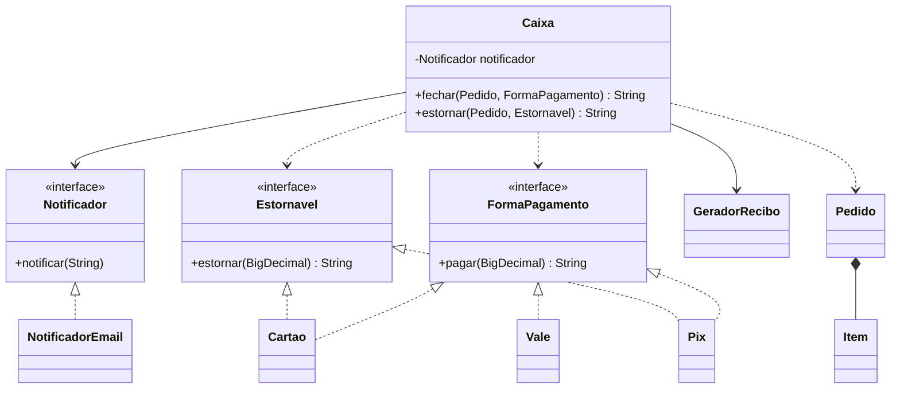

# 064 — SOLID na prática

**Tema:** Os cinco princípios SOLID: antes e depois

## Problema de design

Peça a uma IA "faça o caixa de uma cafeteria" e é provável que venha uma classe só, que soma os itens, cobra com um `switch` sobre o nome da forma de pagamento, imprime o recibo e envia o e-mail. Funciona no primeiro dia. No segundo, chega uma forma de pagamento nova, o recibo muda de formato e alguém quer testar o cálculo sem disparar e-mails: tudo exige mexer na mesma classe. Os princípios SOLID dão nome a cada um desses problemas e dizem como pedir o código já separado.

## Objetivo

Comparar o mesmo caixa de cafeteria em duas versões: `antes`, do jeito que a IA costuma gerar a partir de um pedido vago, e `depois`, refatorado princípio a princípio e coberto por testes. Cada trecho do código está marcado com a letra do princípio que ele mostra.

## Conceitos-chave

- **S** — Responsabilidade única: `Pedido` calcula, `GeradorRecibo` formata e `Caixa` coordena
- **O** — Aberto/fechado: `FormaPagamento` no lugar do `switch`; uma forma nova é uma classe nova
- **L** — Substituição de Liskov: nenhuma forma de pagamento lança `UnsupportedOperationException`
- **I** — Segregação de interfaces: `Estornavel` separada de `FormaPagamento`, porque o vale não estorna
- **D** — Inversão de dependência: `Caixa` recebe um `Notificador` pelo construtor
- Interface funcional implementada com lambda nos testes (`notificacoes::add`)
- Código testável como consequência do bom desenho

## Diagrama de classes



## Classes principais

| Classe | Papel |
|---|---|
| `antes.CaixaCafeteria` | **Antes**: faz tudo; comentários `[S]`, `[O]`, `[L]`, `[I]` e `[D]` apontam cada violação |
| `Pedido`, `Item` | **Depois**: itens e total, nada mais |
| `GeradorRecibo` | Monta o texto do recibo e o devolve como `String` |
| `FormaPagamento` | Interface: `pagar`; implementada por `Cartao`, `Pix` e `Vale` |
| `Estornavel` | Interface: `estornar`; implementada só por `Cartao` e `Pix` |
| `Notificador`, `NotificadorEmail` | Abstração da notificação e sua implementação |
| `Caixa` | Coordena o fechamento: cobra, notifica e devolve o recibo |
| `CaixaTest` | Um teste por princípio, com um notificador falso |
| `SolidApp` | Aplicação: fecha o mesmo pedido com as duas versões |

## Como pedir à IA

Termos que levam a IA a este desenho: **responsabilidade única**, **aberto para extensão, fechado para modificação**, **uma interface por capacidade**, **injeção pelo construtor**, **sem `switch` sobre tipo**, **testável sem e-mail, arquivo ou console**.

Exemplo de pedido:

> Caixa de cafeteria em Java 17, sem frameworks. Siga os princípios SOLID:
>
> - `Pedido` só guarda itens e calcula o total; o recibo é montado por outra classe e devolvido como `String` (nada de `System.out` nas regras).
> - Formas de pagamento (cartão, Pix, vale-refeição) implementam uma interface `FormaPagamento`; uma forma nova não pode exigir mudança no `Caixa`, então não use `switch` nem `if` sobre o tipo.
> - O vale não tem estorno: crie uma interface `Estornavel` separada, implementada só por quem estorna. Nenhuma classe deve lançar `UnsupportedOperationException`.
> - O `Caixa` recebe um `Notificador` (interface) pelo construtor; não crie o serviço de e-mail dentro dele.
>
> Inclua testes JUnit 5 que usem um notificador falso, e diga qual princípio cada classe atende.

## Como revisar o código

Ao receber o código da IA, confira:

- [ ] Nenhuma classe tem "e" na descrição do que faz ("calcula **e** imprime **e** envia")
- [ ] Não há `switch`/`if` sobre o tipo ou o nome da forma de pagamento; uma forma nova entra como classe nova
- [ ] Nenhuma implementação lança `UnsupportedOperationException` ou deixa um método vazio para "cumprir" a interface
- [ ] As interfaces são pequenas; quem implementa usa todos os métodos
- [ ] Dependências externas (e-mail, banco, arquivo, relógio) chegam pelo construtor, como interfaces, e não com `new` dentro da regra de negócio
- [ ] Dá para testar a regra sem console, sem rede e sem arquivo
- [ ] O SOLID não virou exagero: não há interface para classe que nunca vai variar (como `GeradorRecibo`) nem camadas que só repassam chamadas

## Como executar

Na raiz do repositório:

```bash
mvn -q install -DskipTests      # uma única vez: compila tudo e instala a biblioteca da aula 008
mvn -q -pl 10-projetando-com-ia/064-solid-na-pratica exec:java
```

Classe principal: `br.com.cidandrade.aulas.SolidApp`. Na IDE, basta executar essa classe.

Para rodar os testes:

```bash
mvn -q -pl 10-projetando-com-ia/064-solid-na-pratica test
```

Os testes ficam em `src/test/java`. Na IDE, use a opção de executar os testes do projeto.

## Navegação

← [063 — Testes com JUnit](../../10-projetando-com-ia/063-testes-com-junit) · [Sumário do curso](../../README.md#sumário) · [065 — Modelagem de domínio](../../10-projetando-com-ia/065-modelagem-de-dominio) →
