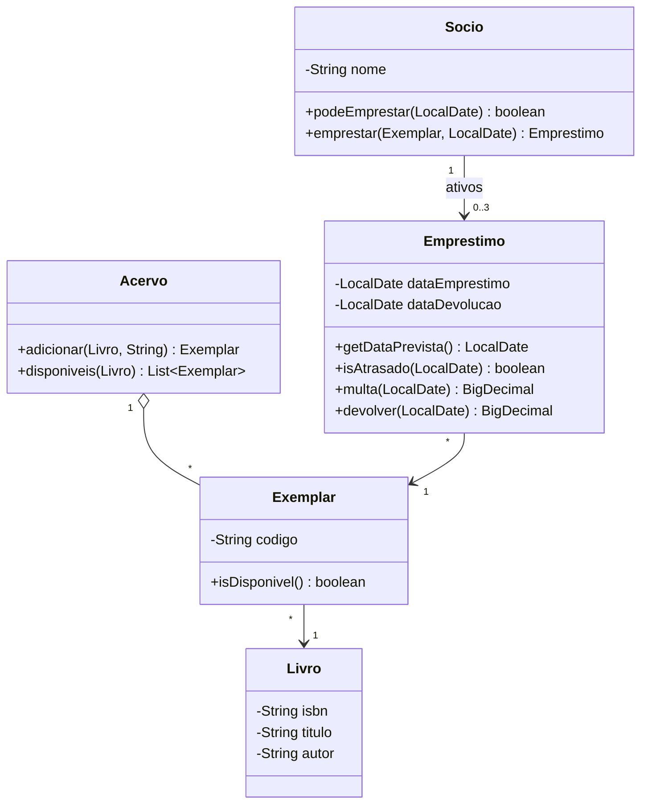

# 065 — Modelagem de domínio

**Tema:** Do enunciado ao diagrama e às classes

## Problema de design

Peça a uma IA "um sistema de empréstimo de livros" e ela decide sozinha quais classes existem. Em geral, junta livro e exemplar numa classe só, com um campo `quantidade`, e põe todas as regras num `BibliotecaService` cheio de getters e setters. O resultado roda, mas não responde a perguntas simples: quem está com qual volume, e quando ele vence? A modelagem é o trabalho que você faz **antes** de pedir: decidir as classes, suas responsabilidades e onde fica cada regra. É ela que transforma um pedido vago num pedido preciso.

## Objetivo

Partir de um enunciado de quatro frases, chegar às classes de uma biblioteca de bairro e implementá-las com as regras **dentro** das entidades. A análise passo a passo (substantivos, verbos, cortes, cartões CRC e onde fica cada regra) está em [MODELAGEM.md](MODELAGEM.md).

## Conceitos-chave

- Do enunciado às classes: substantivos, verbos e cortes
- Distinguir a obra (`Livro`) do objeto físico (`Exemplar`)
- Modelo rico × modelo anêmico: a regra fica com quem tem a informação
- Cartões CRC: classe, responsabilidades, colaboradores
- Identidade: `equals`/`hashCode` pelo ISBN
- Visibilidade de pacote para proteger o estado (`Exemplar.emprestar` não é público)
- Tempo como parâmetro (`LocalDate hoje`) para testar prazos e multas
- `java.time`: `LocalDate`, `plusDays`, `ChronoUnit.DAYS.between`

## Diagrama de classes



## Classes principais

| Classe | Papel |
|---|---|
| `Livro` | A obra; o ISBN define a igualdade |
| `Exemplar` | O volume físico; sabe se está disponível e recusa um segundo empréstimo |
| `Socio` | Aplica o limite de 3 empréstimos e o bloqueio por atraso; é quem empresta |
| `Emprestimo` | Calcula prazo, atraso e multa; registra a devolução e libera o exemplar |
| `Acervo` | Conjunto de exemplares; lista os disponíveis de um livro |
| `EmprestimoTest` | Uma regra do enunciado por teste (13 testes) |
| `BibliotecaApp` | Aplicação: empréstimo devolvido com 3 dias de atraso |

## Como pedir à IA

Termos que levam a IA a este desenho: **modelo de domínio rico (não anêmico)**, **entidades**, **Livro × Exemplar**, **regras dentro das entidades**, **cartões CRC**, **diagrama de classes Mermaid**, **sem setters públicos**.

Exemplo de pedido:

> Vou modelar o controle de empréstimos de uma biblioteca de bairro. Enunciado: [cole o enunciado].
>
> Primeiro, NÃO escreva código. Proponha:
> 1. as classes, separando a obra (`Livro`: ISBN, título, autor) do volume físico (`Exemplar`, com código próprio), pois há títulos com vários exemplares;
> 2. um cartão CRC de cada classe (responsabilidades e colaboradores);
> 3. um diagrama de classes em Mermaid;
> 4. uma tabela dizendo em que classe fica cada regra do enunciado.
>
> Quero um modelo rico: as regras ficam na classe que tem a informação (o limite de 3 no `Socio`, a multa no `Emprestimo`), sem uma classe `BibliotecaService` com toda a lógica e sem setters públicos. Os métodos recebem a data de hoje como `LocalDate`, em vez de chamar `LocalDate.now()`.
>
> Depois que eu aprovar o modelo, peço o código em Java 17 com testes JUnit 5, um por regra.

## Como revisar o código

Ao receber o código da IA, confira:

- [ ] Livro e exemplar são classes distintas; não há um campo `quantidade` no lugar dos exemplares
- [ ] Cada regra do enunciado está na classe que tem a informação para aplicá-la; não há um "Service" ou "Manager" concentrando a lógica
- [ ] As entidades não têm setters públicos para o estado que as regras controlam (empréstimos ativos, disponibilidade)
- [ ] O único caminho para criar um empréstimo passa pela verificação das regras
- [ ] Nenhum método chama `LocalDate.now()` por dentro; a data chega por parâmetro (ou por um relógio injetado)
- [ ] Dinheiro em `BigDecimal`; datas em `java.time`, nunca `Date` ou `Calendar`
- [ ] `equals`/`hashCode` usam a identidade certa (ISBN para livro, código para exemplar) ou não foram sobrescritos sem motivo
- [ ] O modelo não tem classes que o enunciado não pede (autor como entidade, editora, categoria…), a menos que você as tenha pedido

## Como executar

Na raiz do repositório:

```bash
mvn -q install -DskipTests      # uma única vez: compila tudo e instala a biblioteca da aula 008
mvn -q -pl 10-projetando-com-ia/065-modelagem-de-dominio exec:java
```

Classe principal: `br.com.cidandrade.aulas.BibliotecaApp`. Na IDE, basta executar essa classe.

Para rodar os testes:

```bash
mvn -q -pl 10-projetando-com-ia/065-modelagem-de-dominio test
```

Os testes ficam em `src/test/java`. Na IDE, use a opção de executar os testes do projeto.

## Navegação

← [064 — SOLID na prática](../../10-projetando-com-ia/064-solid-na-pratica) · [Sumário do curso](../../README.md#sumário) · [066 — Injeção de dependência](../../10-projetando-com-ia/066-injecao-de-dependencia) →
