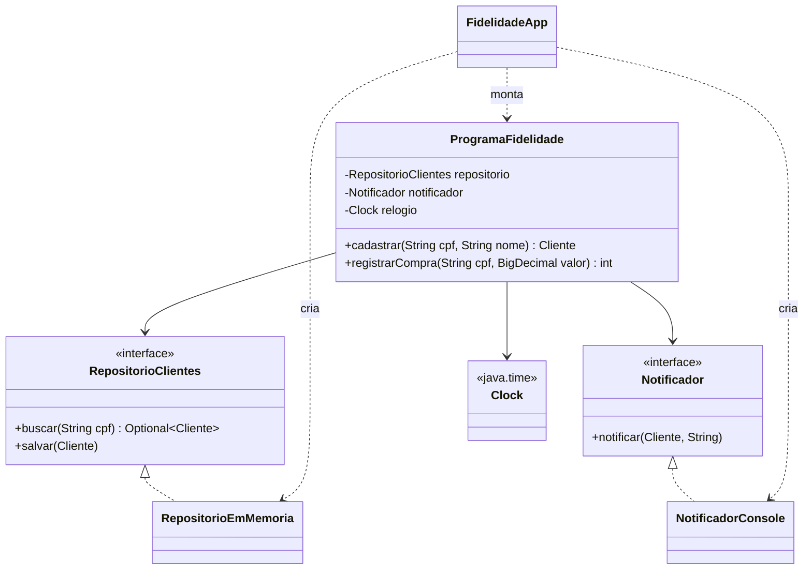

# 066 — Injeção de dependência

**Tema:** Injeção de dependência e interfaces, sem framework

## Problema de design

O código gerado por IA costuma criar as próprias dependências: um `new RepositorioMySQL()` no meio da regra, um `LocalDate.now()` dentro do cálculo, um `System.out.println` no lugar do aviso ao cliente. Tudo funciona até você precisar testar a regra "pontos em dobro às quartas" numa terça, trocar o banco por outro ou mandar o aviso por e-mail. Injeção de dependência é a técnica de **receber** essas peças de fora, como interfaces, em vez de criá-las. Não exige framework: basta um construtor.

## Objetivo

Implementar um programa de fidelidade cujas três dependências (repositório, notificador e relógio) chegam pelo construtor, montar tudo num único ponto (a *composition root*) e testar regras que dependem do dia da semana com um relógio fixo.

## Conceitos-chave

- Dependência escondida × dependência explícita
- Injeção pelo construtor; campos `final`
- Programar para a interface: `RepositorioClientes`, `Notificador`
- *Composition root*: só o `main` conhece as classes concretas
- `java.time.Clock` e `Clock.fixed` para controlar o tempo nos testes
- Dublês de teste: notificador falso com lambda; repositório em memória
- `Optional` como retorno de busca (`orElseThrow`)
- Injeção de dependência não exige framework; Spring e CDI automatizam o mesmo princípio

## Diagrama de classes



## Classes principais

| Classe | Papel |
|---|---|
| `antes.FidelidadeAcoplada` | **Antes**: as mesmas regras com as três dependências escondidas, cada uma comentada |
| `ProgramaFidelidade` | **Depois**: as regras, com repositório, notificador e relógio recebidos pelo construtor |
| `Cliente` | CPF, nome e pontos |
| `RepositorioClientes`, `RepositorioEmMemoria` | Interface do armazenamento e implementação em memória |
| `Notificador`, `NotificadorConsole` | Interface do aviso e implementação no console |
| `ProgramaFidelidadeTest` | Testes com relógio fixo (quarta × quinta) e notificador falso |
| `FidelidadeApp` | **Composition root**: cria as peças concretas e as entrega ao programa |

## Como pedir à IA

Termos que levam a IA a este desenho: **injeção de dependência pelo construtor**, **depender de interfaces**, **composition root**, **`java.time.Clock` injetado**, **sem `new` de infraestrutura na regra de negócio**, **sem framework**.

Exemplo de pedido:

> Programa de fidelidade de uma cafeteria em Java 17, sem frameworks (nada de Spring).
>
> Regras: 1 ponto por real inteiro gasto; pontos em dobro às quartas-feiras; ao chegar a 100 pontos, avisar o cliente uma única vez.
>
> Desenho:
> - `ProgramaFidelidade` recebe pelo construtor, em campos `final`: um `RepositorioClientes` (interface), um `Notificador` (interface) e um `java.time.Clock`.
> - Nenhuma classe de regra pode chamar `new` para criar repositório ou notificador, nem `LocalDate.now()` sem o `Clock`, nem `System.out`.
> - Crie uma implementação em memória de cada interface, e um `main` que seja a única classe a conhecer as implementações concretas.
>
> Inclua testes JUnit 5 com `Clock.fixed` para uma quarta e para uma quinta-feira, e um notificador falso que guarde as mensagens numa lista.

## Como revisar o código

Ao receber o código da IA, confira:

- [ ] A classe de regra não cria nenhuma dependência de infraestrutura com `new` (repositório, conexão, cliente HTTP, notificador)
- [ ] As dependências são campos `final` recebidos pelo construtor, e não por setters nem por um Singleton global
- [ ] Os tipos dos parâmetros do construtor são interfaces, e não classes concretas
- [ ] Não há `LocalDate.now()`, `LocalDateTime.now()` ou `System.currentTimeMillis()` sem um `Clock` injetado
- [ ] Só o `main` (ou a configuração do framework) conhece as classes concretas
- [ ] Os testes não dependem do dia em que rodam: usam `Clock.fixed`
- [ ] A IA não trouxe um framework (Spring, Guice) que você não pediu só para injetar três objetos
- [ ] Não há interfaces para o que nunca varia nem é externo (como `Cliente`)

## Como executar

Na raiz do repositório:

```bash
mvn -q install -DskipTests      # uma única vez: compila tudo e instala a biblioteca da aula 008
mvn -q -pl 10-projetando-com-ia/066-injecao-de-dependencia exec:java
```

Classe principal: `br.com.cidandrade.aulas.FidelidadeApp`. Na IDE, basta executar essa classe.

Para rodar os testes:

```bash
mvn -q -pl 10-projetando-com-ia/066-injecao-de-dependencia test
```

Os testes ficam em `src/test/java`. Na IDE, use a opção de executar os testes do projeto.

## Navegação

← [065 — Modelagem de domínio](../../10-projetando-com-ia/065-modelagem-de-dominio) · [Sumário do curso](../../README.md#sumário) · [067 — Java moderno](../../10-projetando-com-ia/067-java-moderno) →
