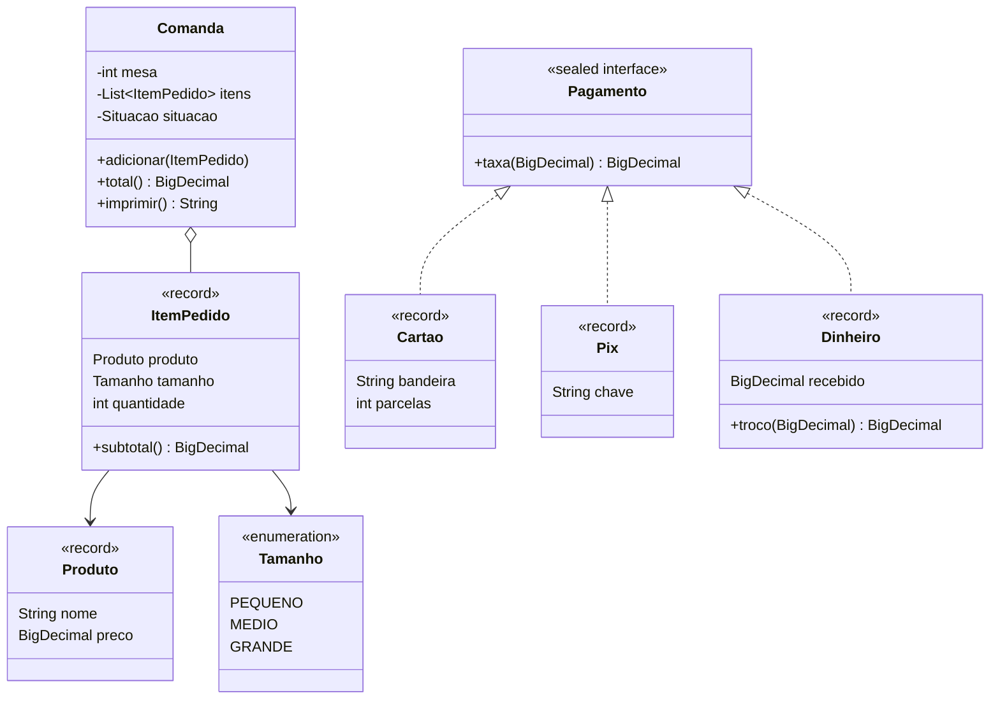

# 067 — Java moderno

**Tema:** Records, sealed, pattern matching, switch como expressão e text blocks

## Problema de design

As IAs aprenderam com muito código recente e escrevem Java moderno: `record` no lugar de POJO, `sealed interface`, `switch` com `->`, text blocks. Se você só conhece o Java clássico, não consegue avaliar se esses recursos foram bem usados. Há dois riscos típicos: usar `record` para algo que muda de estado, e misturar versões, gerando para um projeto Java 17 um código que só compila no Java 21. Esta aula mostra cada recurso no lugar certo e como reconhecer o uso errado.

## Objetivo

Reescrever a comanda da cafeteria com os recursos do Java 14 a 17: records para valores, uma classe comum para a entidade que muda de estado, uma interface selada para as formas de pagamento, pattern matching com `instanceof`, `switch` como expressão e text block. A aula também mostra o `switch` com padrões do Java 21 e por que ele não compila neste curso.

## Conceitos-chave

- `record` (Java 16): imutável; construtor, acessores, `equals`, `hashCode` e `toString` gerados
- Construtor compacto para validar os componentes
- Record para **valor** (`Produto`, `ItemPedido`); classe para **entidade** com estado e identidade (`Comanda`)
- `sealed interface ... permits` (Java 17): um conjunto fechado de implementações
- `instanceof` com pattern matching (Java 16): teste e conversão numa só expressão
- `switch` como expressão (Java 14): `->`, devolve valor e dispensa `default` em enum
- Text block (Java 15) e `String.formatted`
- `var` (Java 10) e `Stream.toList()` (Java 16)
- O `switch` com padrões de tipo e `when` é do Java 21: com `--release 17`, não compila

## Diagrama de classes



## Classes principais

| Classe | Papel |
|---|---|
| `Produto`, `ItemPedido` | **Records**: valores imutáveis, validados no construtor compacto |
| `Tamanho` | Enum com o acréscimo de preço como atributo |
| `Comanda` | **Classe**, não record: muda de estado e tem identidade; usa `switch` como expressão e text block |
| `Pagamento` | **Interface selada**: só `Cartao`, `Pix` e `Dinheiro`, todos records |
| `Pagamentos` | `descrever` com `instanceof` e pattern matching; o Javadoc mostra a versão Java 21 |
| `CardapioTest`, `PagamentoTest` | Igualdade de records, validação, taxas, troco e impressão (19 testes) |
| `CafeteriaApp` | Aplicação: comanda paga com cartão em 3 vezes, usando `var` |

## Como pedir à IA

Termos que levam a IA a este desenho: **Java 17 (diga a versão!)**, **`record` para objetos de valor**, **classe para entidades com estado**, **`sealed interface`**, **pattern matching com `instanceof`**, **`switch` expression**, **text block**.

Exemplo de pedido:

> Projeto em Java 17 (não use nada do Java 21 ou posterior).
>
> - Use `record` para os objetos de valor imutáveis (`Produto(nome, preco)`, `ItemPedido(produto, tamanho, quantidade)`), com validação no construtor compacto.
> - `Comanda` deve ser uma classe comum, e não um record, porque recebe itens e muda de situação (ABERTA, FECHADA, CANCELADA).
> - As formas de pagamento formam um conjunto fechado: use `sealed interface Pagamento permits Cartao, Pix, Dinheiro`, com cada forma como record e o método `taxa` em cada uma.
> - Para descrever o pagamento no recibo, use `instanceof` com pattern matching (o `switch` com padrões não existe no Java 17).
> - Use `switch` como expressão para a descrição da situação e um text block para imprimir a comanda.
>
> Inclua testes JUnit 5 e, no fim, liste em que versão do Java surgiu cada recurso que você usou.

## Como revisar o código

Ao receber o código da IA, confira:

- [ ] O código compila na versão do projeto: nada de `switch` com padrões, record patterns ou `when` (Java 21) num projeto Java 17
- [ ] `record` foi usado só para valores imutáveis; entidades que mudam de estado ou têm identidade continuam classes
- [ ] Os records validam os dados no construtor compacto, em vez de aceitar qualquer valor
- [ ] Um record com uma `List` não a expõe para alteração (copie com `List.copyOf` no construtor compacto)
- [ ] `sealed` só aparece onde o conjunto de tipos é realmente fechado; se outros vão poder criar novos tipos, a interface deve ser aberta
- [ ] Uma operação que pertence a cada tipo virou método do tipo (polimorfismo), e não uma cadeia de `instanceof` em outra classe
- [ ] `var` só onde o tipo é óbvio pelo lado direito
- [ ] Não há Lombok `@Data`/`@Value` onde um record resolve, nem record onde o projeto pede Lombok por padrão

## Como executar

Na raiz do repositório:

```bash
mvn -q install -DskipTests      # uma única vez: compila tudo e instala a biblioteca da aula 008
mvn -q -pl 10-projetando-com-ia/067-java-moderno exec:java
```

Classe principal: `br.com.cidandrade.aulas.CafeteriaApp`. Na IDE, basta executar essa classe.

Para rodar os testes:

```bash
mvn -q -pl 10-projetando-com-ia/067-java-moderno test
```

Os testes ficam em `src/test/java`. Na IDE, use a opção de executar os testes do projeto.

## Navegação

← [066 — Injeção de dependência](../../10-projetando-com-ia/066-injecao-de-dependencia) · [Sumário do curso](../../README.md#sumário) · [068 — Projeto integrador](../../10-projetando-com-ia/068-projeto-integrador) →
