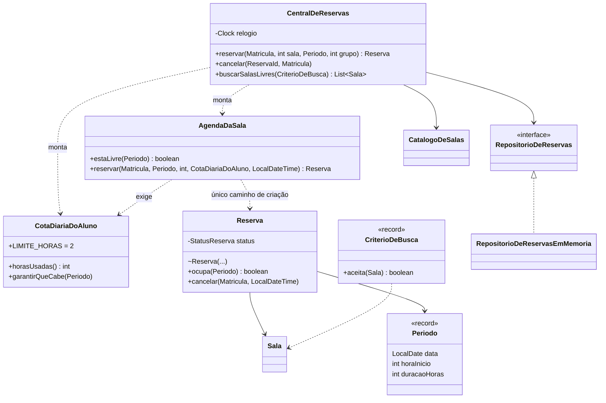

# 068 — Projeto integrador

**Tema:** Ciclo completo com IA: especificar, pedir, revisar, testar

## Problema de design

As aulas anteriores mostraram cada peça isoladamente: testes como especificação, SOLID, modelagem, injeção de dependência, Java moderno. Num projeto de verdade, tudo acontece junto, numa conversa com a IA que dura várias rodadas. É preciso decidir o que pedir primeiro, o que conferir em cada resposta, quando aceitar, quando pedir correção e como saber se os testes que a própria IA escreveu são bons.

## Objetivo

Acompanhar um ciclo **real** de projeto com IA, um sistema de reserva de salas de estudo, em quatro rodadas: desenho, testes, código e correção. Os pedidos e as respostas estão na íntegra em [`ia/`](ia), e todo o código de `src/` saiu dessas respostas sem alteração. O diário com a revisão de cada rodada, os testes de mutação e as lições está em [PROCESSO.md](PROCESSO.md).

## Conceitos-chave

- Desenho antes do código: CRC, diagrama e tabela regra → classe no primeiro pedido
- Testes antes do código, aprovados e congelados ("sem alterar nenhum teste")
- Ler as premissas da IA: regras acrescentadas e pontos em aberto
- Revisão em camadas: leitura, compilação, testes, execução e testes de mutação
- Teste de mutação: quebrar o código de propósito para medir a qualidade dos testes
- Repositório espião e teste de contrato para verificar a persistência
- *Identity map*: por que um repositório em memória pode esconder um bug de gravação
- Pedido de correção que explica o princípio, e não só o sintoma

## Diagrama de classes



## Classes principais

| Classe | Papel |
|---|---|
| `Periodo` | **Record**: horário de 1 a 2 horas cheias entre 8h e 22h; sobreposição e "já começou" |
| `Matricula`, `Recursos`, `ReservaId`, `CriterioDeBusca` | **Records** de valor; `CriterioDeBusca.aceita(Sala)` filtra as salas |
| `Sala`, `CatalogoDeSalas` | A sala (capacidade e recursos) e o conjunto das salas, sem números repetidos |
| `Reserva` | Entidade com status; recusa grupo grande e horário passado; cancela até 1 hora antes, só pelo dono |
| `AgendaDaSala` | Único caminho para criar uma reserva: confere a cota e o conflito de horário |
| `CotaDiariaDoAluno` | Limite de 2 horas por aluno por dia |
| `RepositorioDeReservas`, `RepositorioDeReservasEmMemoria` | Armazenamento atrás de interface |
| `CentralDeReservas` | Coordena os casos de uso com o `Clock` injetado; não decide nenhuma regra |
| `ReservasApp` | *Composition root* e cenário de demonstração |
| `15 classes de teste` | 162 testes, incluindo o repositório espião e o contrato do repositório |

## Como pedir à IA

Termos que levam a IA a este desenho: **só o desenho primeiro, sem código**, **cartões CRC e tabela regra → classe**, **modelo rico**, **testes antes do código**, **sem alterar nenhum teste**, **liste suas premissas e os pontos em aberto**.

Exemplo de pedido:

> Estou projetando um sistema em Java 17, sem frameworks. Enunciado:
>
> A faculdade tem salas de estudo que os alunos reservam. Cada sala tem um número, uma capacidade e pode ter projetor e/ou lousa digital. As salas funcionam das 8h às 22h, e as reservas são em horas cheias, de 1 a 2 horas seguidas. Uma sala não pode ter duas reservas no mesmo horário. Cada aluno pode reservar no máximo 2 horas por dia, somando todas as reservas dele. O tamanho do grupo informado na reserva não pode passar da capacidade da sala. O aluno pode cancelar até 1 hora antes do início; depois disso, não. Não se pode reservar no passado. O aluno precisa poder buscar as salas livres num horário, com uma capacidade mínima e, opcionalmente, exigindo projetor.
>
> Antes de qualquer código, proponha:
>
> 1. as classes, com as responsabilidades e os colaboradores de cada uma (como cartões CRC);
> 2. um diagrama de classes em Mermaid;
> 3. uma tabela dizendo em que classe fica cada regra do enunciado.
>
> Quero um modelo rico: cada regra fica na classe que tem a informação para aplicá-la, sem uma classe "Service" concentrando toda a lógica e sem setters públicos. A data e a hora atuais devem vir de um `java.time.Clock` injetado, e o armazenamento das reservas deve ficar atrás de uma interface, com uma implementação em memória. Use `record` onde fizer sentido para objetos de valor.
>
> Não escreva o código ainda.
>
> (Pedido real da rodada 1. Os outros três estão em ia/.)

## Como revisar o código

Ao receber o código da IA, confira:

- [ ] Rodada de desenho: cada regra do enunciado está numa classe que tem a informação; as garantias valem para todas as regras, e não só para algumas
- [ ] Rodada de desenho: as premissas da IA foram lidas, e cada regra acrescentada foi aceita ou recusada de forma explícita
- [ ] Rodada de testes: todos os casos de borda pedidos estão lá; os pontos em aberto foram decididos por você
- [ ] Rodada de código: compila, os testes passam, o app roda e nenhum teste foi alterado
- [ ] Teste de mutação: quebrar cada regra de propósito faz algum teste falhar
- [ ] A persistência é verificada de verdade (espião ou contrato), e não só pelo repositório em memória
- [ ] Código defensivo que a IA apresenta como vantagem tem teste
- [ ] Métodos e dependências não pedidos (como `todas()` ou um `pom.xml` próprio) foram removidos ou ignorados

## Como executar

Na raiz do repositório:

```bash
mvn -q install -DskipTests      # uma única vez: compila tudo e instala a biblioteca da aula 008
mvn -q -pl 10-projetando-com-ia/068-projeto-integrador exec:java
```

Classe principal: `reservas.ReservasApp`. Na IDE, basta executar essa classe.

Para rodar os testes:

```bash
mvn -q -pl 10-projetando-com-ia/068-projeto-integrador test
```

Os testes ficam em `src/test/java`. Na IDE, use a opção de executar os testes do projeto.

## Navegação

← [067 — Java moderno](../../10-projetando-com-ia/067-java-moderno) · [Sumário do curso](../../README.md#sumário) · [E001 — Números primos](../../exercicios/E001-numeros-primos) →
