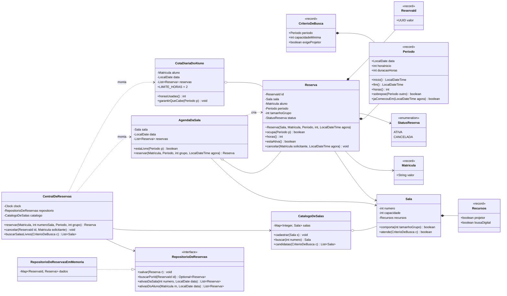

# Rodada 1 — Resposta da IA: o desenho

Resposta recebida na íntegra, sem edição.

---

# Sistema de reservas de salas de estudo: proposta de modelo

## 0. Ideia geral

Duas regras do enunciado olham para várias reservas ao mesmo tempo:

- "uma sala não pode ter duas reservas no mesmo horário";
- "cada aluno pode reservar no máximo 2 horas por dia".

Nenhuma reserva sozinha tem informação para decidir isso. Se essas regras não ganharem uma casa própria, elas acabam caindo num `ReservaService`. Por isso o modelo tem dois objetos de domínio que representam um conjunto de reservas:

- **`AgendaDaSala`**: as reservas de uma sala num dia;
- **`CotaDiariaDoAluno`**: as reservas de um aluno num dia.

Ainda vai existir uma classe de entrada, a `CentralDeReservas`. Ela só coordena: pega o "agora" no `Clock`, busca dados no repositório, chama os objetos de domínio e salva. Ela não tem nenhum `if` de regra de negócio.

Um teste ajuda a ver a diferença para um Service: se você apagar a `CentralDeReservas`, nenhuma regra do enunciado some do código. Ela não decide nada.

---

## 1. Cartões CRC

### Objetos de valor (`record`)

**`Periodo`**, um `record` com `(LocalDate data, int horaInicio, int duracaoHoras)`

| Responsabilidades | Colaboradores |
|---|---|
| Garantir na construção que o horário fica entre 8h e 22h (`horaInicio >= 8` e `horaInicio + duracao <= 22`) | `java.time` |
| Garantir horas cheias. Isso já vem do tipo: a hora de início é um `int`, não um `LocalTime` | |
| Garantir que a duração é de 1 a 2 horas | |
| Dar `inicio()` e `fim()` como `LocalDateTime` | |
| Responder se se sobrepõe a outro período: `sobrepoe(Periodo)` | |
| Responder se já começou num instante: `jaComecouEm(LocalDateTime agora)` | |
| Informar quantas horas ocupa: `horas()` | |

**`Matricula`**, um `record` com `(String valor)`

| Responsabilidades | Colaboradores |
|---|---|
| Identificar o aluno e validar que não é vazia | nenhum |

**`Recursos`**, um `record` com `(boolean projetor, boolean lousaDigital)`

| Responsabilidades | Colaboradores |
|---|---|
| Dizer quais equipamentos a sala tem | nenhum |

**`CriterioDeBusca`**, um `record` com `(Periodo periodo, int capacidadeMinima, boolean exigeProjetor)`

| Responsabilidades | Colaboradores |
|---|---|
| Guardar o que o aluno quer encontrar e validar que `capacidadeMinima >= 1` | `Periodo` |

**`ReservaId`**, um `record` com `(UUID valor)`

| Responsabilidades | Colaboradores |
|---|---|
| Identificar uma reserva | nenhum |

### Entidades e objetos de domínio

**`Sala`**: classe `final` e imutável. A identidade é o número, então `equals` e `hashCode` usam só o número.

| Responsabilidades | Colaboradores |
|---|---|
| Conhecer número, capacidade e recursos | `Recursos` |
| Validar que a capacidade é maior que 0 | |
| Responder se um grupo cabe nela: `comporta(int tamanhoGrupo)` | |
| Responder se atende aos requisitos fixos de uma busca: `atende(CriterioDeBusca)`, ou seja, capacidade suficiente e projetor quando ele for exigido | `CriterioDeBusca` |

**`Reserva`**: entidade com estado (`ATIVA` ou `CANCELADA`) e sem setters.

| Responsabilidades | Colaboradores |
|---|---|
| Conhecer id, sala, aluno, período, tamanho do grupo e status | `Sala`, `Matricula`, `Periodo`, `StatusReserva` |
| Na criação, recusar um grupo maior que a sala (pergunta para `sala.comporta`) e um tamanho de grupo menor que 1 | `Sala` |
| Na criação, recusar um período que já começou (pergunta para `periodo.jaComecouEm(agora)`) | `Periodo` |
| Responder se ocupa um período: `ocupa(Periodo)`, que é verdadeiro se está ativa e se sobrepõe | `Periodo` |
| Informar as horas que consome: `horas()`, que vale 0 se estiver cancelada | |
| Cancelar-se: `cancelar(Matricula solicitante, LocalDateTime agora)`. Recusa se o solicitante não for o dono, se já estiver cancelada ou se `agora` for depois de `inicio - 1h` | `Periodo`, `Matricula` |

**`AgendaDaSala`**: a sala mais as reservas ativas dela num dia. É montada na hora, a partir do repositório.

| Responsabilidades | Colaboradores |
|---|---|
| Responder se a sala está livre num período: `estaLivre(Periodo)` | `Reserva` |
| Criar uma nova reserva só se não houver conflito: `reservar(Matricula, Periodo, int grupo, LocalDateTime agora)` devolve uma `Reserva` | `Sala`, `Reserva`, `Periodo` |
| Garantir que o período é do mesmo dia da agenda | `Periodo` |

**`CotaDiariaDoAluno`**: o aluno mais as reservas ativas dele num dia. Tem a constante `LIMITE_HORAS = 2`.

| Responsabilidades | Colaboradores |
|---|---|
| Somar as horas já usadas no dia: `horasUsadas()` | `Reserva` |
| Recusar um período que estouraria o limite: `garantirQueCabe(Periodo)` | `Periodo` |

**`StatusReserva`**: enum com `ATIVA` e `CANCELADA`.

**`RegraVioladaException`**: uma `RuntimeException` com uma mensagem legível para o aluno.

### Armazenamento

**`RepositorioDeReservas`** (interface)

| Responsabilidades | Colaboradores |
|---|---|
| `salvar(Reserva)` | `Reserva` |
| `buscarPorId(ReservaId)`, que devolve `Optional<Reserva>` | |
| `ativasDaSala(int numeroSala, LocalDate data)` | |
| `ativasDoAluno(Matricula, LocalDate data)` | |

**`RepositorioDeReservasEmMemoria`**, que implementa a interface acima

| Responsabilidades | Colaboradores |
|---|---|
| Guardar as reservas num `Map<ReservaId, Reserva>` e filtrar pelas consultas | `Reserva` |

**`CatalogoDeSalas`**

| Responsabilidades | Colaboradores |
|---|---|
| Cadastrar salas e recusar número repetido | `Sala` |
| `buscar(int numero)` | |
| `candidatas(CriterioDeBusca)`, que filtra com `sala.atende(...)` | `CriterioDeBusca` |

O enunciado só pede interface para as reservas. Por isso o catálogo pode ser uma classe concreta. Se quiser, dá para extrair uma interface depois, do mesmo jeito.

### Coordenação

**`CentralDeReservas`**: ponto de entrada, recebe tudo pelo construtor.

| Responsabilidades | Colaboradores |
|---|---|
| Obter o "agora" com `LocalDateTime.now(clock)` | `Clock` |
| **reservar**: buscar a sala, montar a `CotaDiariaDoAluno` e chamar `garantirQueCabe`, montar a `AgendaDaSala` e chamar `reservar`, salvar | `CatalogoDeSalas`, `RepositorioDeReservas`, `AgendaDaSala`, `CotaDiariaDoAluno` |
| **cancelar**: buscar a reserva, chamar `reserva.cancelar(aluno, agora)` e salvar | `Reserva` |
| **buscarSalasLivres**: pegar as candidatas do catálogo e manter só as que têm `agenda.estaLivre(periodo)` | `CatalogoDeSalas`, `AgendaDaSala` |

Uma decisão de projeto: o `Clock` fica só na `CentralDeReservas`, e o domínio recebe um `LocalDateTime agora` como parâmetro. Assim `Reserva` e `Periodo` não dependem de onde vem a hora e podem ser testados com datas literais. Nos testes da `CentralDeReservas`, você usa `Clock.fixed(...)`.

---

## 2. Diagrama de classes (Mermaid)

O construtor de `Reserva` é *package-private* (o `~` no diagrama). Assim, fora do pacote de domínio, a única forma de criar uma reserva é pela `AgendaDaSala`. Isso impede que alguém crie uma reserva sem passar pela checagem de conflito.

---

## 3. Onde fica cada regra

| # | Regra do enunciado | Classe | Método ou momento | Por que ali |
|---|---|---|---|---|
| 1 | A sala tem número, capacidade, projetor e/ou lousa | `Sala` + `Recursos` | construtor, que valida capacidade maior que 0 | São os dados da sala |
| 2 | Funciona das 8h às 22h | `Periodo` | construtor compacto do record | Só o período conhece hora de início e fim |
| 3 | Reservas em horas cheias | `Periodo` | tipo `int horaInicio` | Garantido pelo próprio tipo, sem minutos possíveis |
| 4 | De 1 a 2 horas seguidas | `Periodo` | construtor compacto | A duração é dado do período |
| 5 | A sala não pode ter duas reservas no mesmo horário | `AgendaDaSala` (usa `Reserva.ocupa`, que usa `Periodo.sobrepoe`) | `reservar` / `estaLivre` | É o único objeto que vê todas as reservas da sala no dia |
| 6 | Máximo de 2 horas por dia por aluno, somando tudo | `CotaDiariaDoAluno` | `garantirQueCabe` | É o único objeto que vê todas as reservas do aluno no dia |
| 7 | Grupo não pode passar da capacidade | `Sala.comporta`, chamado pela `Reserva` | construtor da `Reserva` | A sala conhece a capacidade; a reserva conhece o grupo |
| 8 | Cancelar só até 1 hora antes do início | `Reserva` | `cancelar(solicitante, agora)` | A reserva conhece o próprio início e o próprio status |
| 9 | Não se pode reservar no passado | `Periodo.jaComecouEm`, chamado pela `Reserva` | construtor da `Reserva` | O período sabe quando começa; o "agora" chega como parâmetro |
| 10a | Busca com capacidade mínima e projetor opcional | `Sala` | `atende(CriterioDeBusca)` | São atributos da sala |
| 10b | Busca só de salas livres no horário | `AgendaDaSala` | `estaLivre(Periodo)` | Mesma informação da regra 5, então a regra fica num lugar só |
| — | Data e hora atuais vêm de um `Clock` | `CentralDeReservas` | `LocalDateTime.now(clock)` | Única borda com o mundo externo, injetada pelo construtor |
| — | Armazenamento atrás de interface | `RepositorioDeReservas` / `...EmMemoria` | — | O domínio não sabe se é memória, arquivo ou banco |

---

## 4. Premissas que adotei (confira com o professor)

1. **Reservas canceladas** não contam para conflito de horário nem para a cota de 2 horas.
2. **"Até 1 hora antes"** inclui o limite. Para uma reserva às 14h, dá para cancelar às 13:00:00, mas não às 13:00:01.
3. **Só o dono da reserva pode cancelar.** O enunciado não diz isso, mas sem essa regra qualquer aluno cancelaria a reserva de outro.
4. **O limite de 2 horas** vale para o dia do período reservado, não para o dia em que a reserva foi feita.
5. **Reservar para hoje** é permitido, desde que o horário ainda não tenha começado.
6. **Concorrência**: o fluxo "verifica e depois salva" não é atômico. Para um sistema em memória com uma thread só, isso basta. Se precisar, marque os métodos da `CentralDeReservas` como `synchronized`.
7. **Restaurar reservas antigas**: a checagem de "passado" fica no construtor da `Reserva`. Com o repositório em memória isso não atrapalha, porque os objetos nunca são recriados. Se um dia você carregar reservas antigas de um arquivo, vai precisar de uma forma de recriá-las sem essa validação.

Quando você aprovar esse desenho, podemos ir para o código. Uma sugestão de ordem: comece por `Periodo` e pelos testes dele, porque quase todas as outras classes dependem dele.
