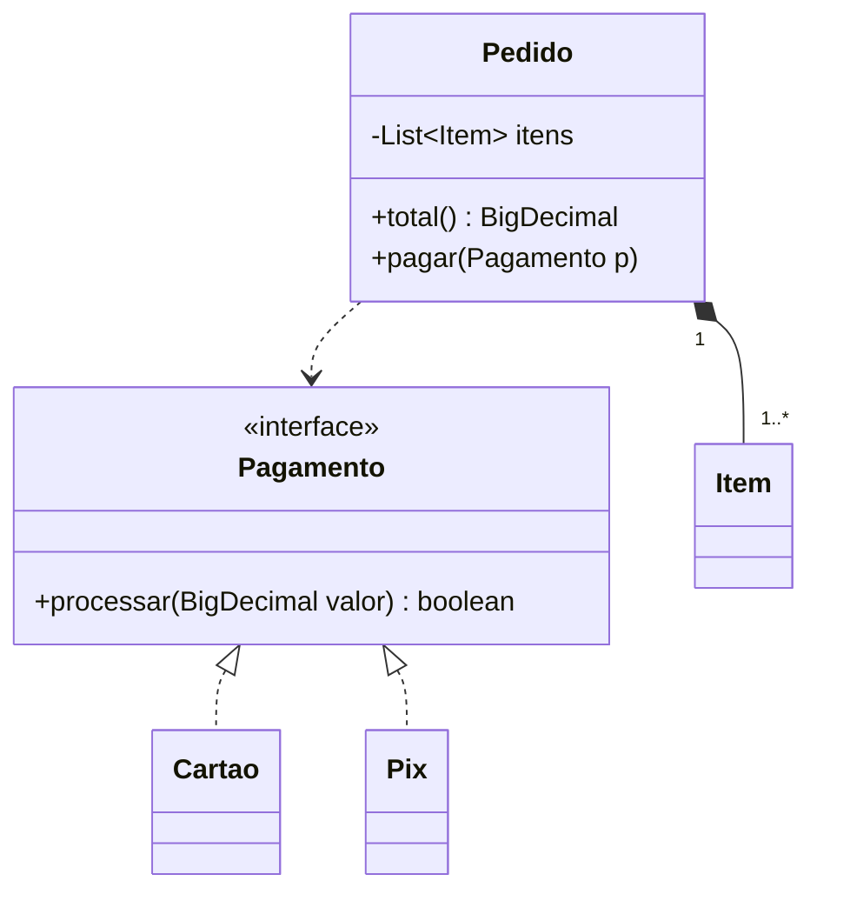

# 1. Pensar em objetos

Antes de abrir o chat com a IA, faça um rascunho do projeto. Não precisa de código; uma folha de papel basta. Esse rascunho é o que você vai descrever no pedido e o que vai usar para conferir a resposta.

## Do enunciado às classes

Pegue o enunciado do sistema e faça três leituras.

1. **Substantivos viram candidatos a classe.** Em "o cliente faz um pedido com vários itens e paga com cartão ou Pix", os candidatos são cliente, pedido, item, pagamento, cartão e Pix.
2. **Verbos viram candidatos a método,** e o método fica na classe que tem os dados para executá-lo. "Calcular o total" fica em `Pedido`, porque é o pedido que conhece os itens.
3. **"É um" sugere herança ou interface; "tem um" sugere composição.** Cartão *é uma* forma de pagamento; pedido *tem* itens.

Depois, corte: alguns substantivos são só atributos (o "nome" do cliente não precisa de classe própria) e alguns verbos pertencem ao mundo de fora (o cliente "escolhe", mas o sistema não precisa de um método para isso).

## Responsabilidades e colaborações

Para cada classe que sobrou, escreva duas listas, como num cartão CRC (*Classe, Responsabilidades, Colaboradores*):

| `Pedido` | |
|---|---|
| **Responsabilidades** | guardar os itens; calcular o total; mudar de situação (aberto → pago → enviado) |
| **Colaboradores** | `Item`, `Pagamento`, `Cliente` |

Sinais de alerta no cartão:

- **Responsabilidades demais** (mais de quatro ou cinco, ou sem relação entre si): a classe quer ser dividida.
- **Colaboradores demais:** a classe sabe demais sobre o sistema; talvez falte um intermediário (veja o [Mediator](../07-padroes-comportamentais/048-chat) e a [Facade](../06-padroes-estruturais/038-novo-carro)).
- **Nenhuma responsabilidade além de guardar dados:** pode ser só um registro de dados, ou pode ser que o comportamento dela esteja espalhado em outras classes.

## O que varia e o que fica

A pergunta mais útil do projeto orientado a objetos é: **o que vai mudar?** Formas de pagamento novas, regras de desconto que mudam todo mês, um banco de dados que pode ser trocado… Cada ponto de variação pede uma interface, com implementações trocáveis atrás dela. É essa pergunta que leva aos padrões de projeto (veja o [mapa problema → padrão](05-mapa-problema-padrao.md)).

No exemplo, pagamento varia: amanhã surge o boleto. Então `Pagamento` vira uma interface, e `Cartao` e `Pix`, implementações. O `Pedido` conhece só a interface.

## Desenhe antes de pedir

Um diagrama de classes curto organiza o seu raciocínio e também pode ir no pedido. Muitas IAs entendem a notação [Mermaid](https://mermaid.js.org/syntax/classDiagram.html), que o GitHub também desenha:

## Aulas relacionadas

- [002 — Carro](../01-fundamentos/002-carro): classe, estado e comportamento.
- [003 — Herança](../01-fundamentos/003-heranca) e [004 — Interface](../01-fundamentos/004-interface): "é um" com e sem implementação.
- [051 — Cães Polimórficos](../07-padroes-comportamentais/051-caes-polimorficos): composição em vez de herança para o que varia.
- [065 — Modelagem de domínio](../10-projetando-com-ia/065-modelagem-de-dominio): este método aplicado do começo ao fim, numa biblioteca de bairro.

---

[Guia](README.md) · [2. Vocabulário de design](02-vocabulario-de-design.md) →
