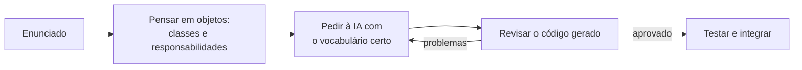

# Guia: projetar com IA

Uma IA escreve código orientado a objetos rapidamente, mas o desenho que ela entrega depende do que você pede. Com um pedido vago, ela devolve uma classe enorme que faz tudo. Com um pedido que nomeia responsabilidades, colaborações e padrões, devolve um projeto que dá para manter. E, para saber se o resultado está bom, você precisa revisá-lo.

Este guia reúne o que vale para o curso todo. As aulas mostram cada ideia em código que funciona.

| Capítulo | Pergunta que responde |
|---|---|
| [1. Pensar em objetos](01-pensar-em-objetos.md) | Como transformar um enunciado em classes, antes de falar com a IA? |
| [2. Vocabulário de design](02-vocabulario-de-design.md) | Que termos fazem a IA entender o desenho que eu quero? |
| [3. Como pedir](03-como-pedir.md) | O que um bom pedido de projeto orientado a objetos precisa conter? |
| [4. Como revisar](04-como-revisar.md) | Como saber se o código gerado está bem projetado? |
| [5. Mapa problema → padrão](05-mapa-problema-padrao.md) | Reconheço este problema no meu projeto. Que padrão peço? |

## O ciclo de trabalho

Quem pula a etapa B pede "faça um sistema de biblioteca" e aceita o que vier. Quem faz a etapa B consegue dizer à IA o que quer e consegue recusar o que não serve.

[← Voltar ao sumário do curso](../README.md#sumário)
